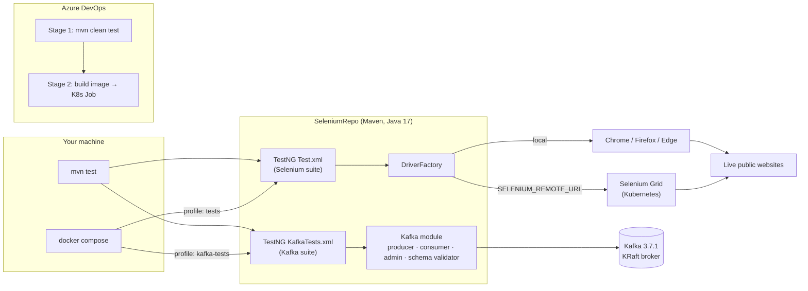

<div align="center">

# Claude Code · Selenium Automation Project

**Java 17 test automation workspace with Selenium WebDriver 4, TestNG, Apache Kafka, Docker, Kubernetes and Azure DevOps CI**


<br/>


[Overview](#-overview) ·
[Quick start](#-quick-start) ·
[Selenium](#-selenium--testng) ·
[Kafka](#-apache-kafka-module) ·
[Docker](#-docker-compose) ·
[Kubernetes](#-kubernetes) ·
[CI/CD](#-cicd-azure-devops) ·
[Author](#-author)

</div>

---

## 📌 Overview

This repository takes a classic Selenium learning project and grows it, with the help of [Claude Code](https://claude.com/claude-code), into a containerised, CI-ready automation workspace. It holds:

| Part | What it is |
|------|------------|
| **[`SeleniumRepo/`](./SeleniumRepo)** | Maven project (Java 17) with 20+ standalone Selenium WebDriver concept demos, a TestNG suite, a pluggable `DriverFactory` (local or Selenium Grid), plus a reusable **Apache Kafka** module with schema-validated producer/consumer utilities |
| **[`docker-compose.yml`](./docker-compose.yml)** | One file that runs every part on its own via profiles: Selenium tests in headless Chrome, a Kafka broker, Kafka tests, and a hello-world program |
| **[`SeleniumRepo/k8s/`](./SeleniumRepo/k8s)** | Kubernetes manifests: a Selenium Grid Deployment + Service and a run-to-completion test Job |
| **[`SeleniumRepo/azure-pipelines.yml`](./SeleniumRepo/azure-pipelines.yml)** | Two-stage Azure DevOps pipeline: run tests on the agent, then build/push the image and run the suite as a Kubernetes Job |
| **[`mytest.java`](./mytest.java)** | A tiny standalone Java program (prints `Hello Arpit`) with a multi-stage, non-root Docker image |
| **`CLAUDE.md`** files | Project guidance for Claude Code at the [root](./CLAUDE.md) and in [`SeleniumRepo`](./SeleniumRepo/CLAUDE.md) |

## 🧭 Architecture



## 📂 Repository structure

```text
Claude-Code-Selenium-Automation-Project/
├── README.md                     ← you are here
├── CLAUDE.md                     ← Claude Code guidance (workspace)
├── docker-compose.yml            ← profiles: hello, tests, kafka, kafka-tests
├── Dockerfile                    ← multi-stage image for mytest.java
├── mytest.java                   ← standalone "Hello Arpit" program
└── SeleniumRepo/
    ├── pom.xml                   ← Java 17, Selenium 4.11.0, TestNG 7.8.0, kafka-clients 3.7.1
    ├── Dockerfile                ← Maven + JDK 17 + Google Chrome (headless)
    ├── azure-pipelines.yml       ← CI: test stage + Kubernetes stage
    ├── CLAUDE.md                 ← Claude Code guidance (project)
    ├── k8s/                      ← namespace, Selenium Grid deployment/service, test Job
    └── src/
        ├── main/java/
        │   ├── SeleniumSess/             ← Selenium concept demos + SeleniumUtil, ElementUtil
        │   └── com/masterclass/kafka/    ← config, admin, producer, consumer, json, model, validation
        ├── main/resources/
        │   └── schemas/order-event.schema.json
        ├── test/java/
        │   ├── TestNGClass/              ← TestNG examples + DriverFactory
        │   └── com/masterclass/kafka/    ← unit, mock and integration tests
        └── test/resources/TestRunner/
            ├── Test.xml                  ← Selenium suite (default)
            └── KafkaTests.xml            ← Kafka suite
```

## ⚡ Quick start

### Prerequisites

| Tool | Needed for |
|------|-----------|
| JDK 17+ | Building and running anything locally |
| Maven 3.9+ | `mvn test` on your machine |
| Docker + Compose plugin | Running everything in containers (no local JDK/Maven/browser needed) |
| `kubectl` + a cluster | Optional: Kubernetes runs (Docker Desktop, minikube or kind) |
| Internet access | Maven dependencies, Selenium Manager driver downloads, and the live test sites |

### Clone

```bash
git clone https://github.com/ArpitChoubey/Claude-Code-Selenium-Automation-Project.git
cd Claude-Code-Selenium-Automation-Project
```

### Fastest path: Docker only

```bash
docker compose --profile tests run --rm selenium-tests          # Selenium suite in headless Chrome
docker compose --profile kafka-tests run --rm kafka-tests       # Kafka broker + Kafka suite
```

Reports land on your machine in `SeleniumRepo/test-output` (TestNG) and `SeleniumRepo/target` (Surefire).

### Local Maven

```bash
cd SeleniumRepo
mvn clean test-compile                               # check that everything compiles
mvn clean test                                       # run the Selenium suite (Test.xml)
mvn test -Dbrowser=chrome -Dheadless=true            # pick browser / headless mode
mvn test -Dtest=AbzTest                              # one test class
mvn test -Dtest=AbzTest#ABCTest                      # one test method
```

> On Windows PowerShell, quote `-D` arguments that contain `=` or `.`, for example `mvn test "-Dtestng.suite=src/test/resources/TestRunner/KafkaTests.xml"`.

## 🌐 Selenium + TestNG

### Concepts demonstrated

Each class in [`src/main/java/SeleniumSess`](./SeleniumRepo/src/main/java/SeleniumSess) is a self-contained demo with its own `main` method, so you can run it straight from the IDE.

| Area | Examples |
|------|----------|
| Browser & navigation | `SeleniumBasic`, `WebDriverMethods`, `Navigation`, `HeadlessBrowser` |
| Locators | `LocatorConcept`, `RelativeLocator` (Selenium 4), `ElementAttributeConcept`, `GetTextForText`, `TotalLinks`, `FooterSection` |
| Windows & tabs | `BrowserWindowHandle`, `BrowserMultipleWindow` |
| Alerts & pop-ups | `AlertJSPop` |
| Forms & inputs | `DropDown`, `FileUpload`, `RegPage`, `GoogleLang` |
| Synchronisation | `WaitsInSel` (implicit / explicit / `WebDriverWait`) |
| Exceptions | `StaleElementRefExceptionConcept` |
| Reusable helpers | `SeleniumUtil` (driver init, URL/title, quit) and `ElementUtil` (elements, dropdowns, waits, alerts, frames) |

TestNG examples in [`src/test/java/TestNGClass`](./SeleniumRepo/src/test/java/TestNGClass) cover `@BeforeMethod`/`@AfterMethod`, `priority`, `dependsOnMethods`, `expectedExceptions` and `@DataProvider`. The default suite [`Test.xml`](./SeleniumRepo/src/test/resources/TestRunner/Test.xml) runs `AbzTest` and `XYZTest` with `parallel="tests"`.

### Driver configuration

Tests get their browser from `DriverFactory.createDriver()`. Set options as a system property or an environment variable:

| System property | Environment variable | Values | Default |
|-----------------|----------------------|--------|---------|
| `browser` | `BROWSER` | `firefox`, `chrome`, `edge` | `firefox` |
| `headless` | `HEADLESS` | `true`, `false` | `false` |
| `selenium.remote.url` | `SELENIUM_REMOTE_URL` | Grid URL, e.g. `http://localhost:4444` | empty (local browser) |

When a remote URL is set, a `RemoteWebDriver` is used instead of a local browser. The Docker image sets `BROWSER=chrome` and `HEADLESS=true`.

## 📨 Apache Kafka module

A reusable, test-friendly Kafka toolkit in [`com.masterclass.kafka`](./SeleniumRepo/src/main/java/com/masterclass/kafka):

| Class | Responsibility |
|-------|----------------|
| `config.KafkaConfig` | Broker address from `-Dkafka.bootstrap.servers` → `KAFKA_BOOTSTRAP_SERVERS` → `localhost:9092`; reliable defaults (`acks=all`, idempotent producer, `read_committed` consumer with manual commits) |
| `admin.KafkaTopicManager` | Create (idempotent), list, describe and delete topics; blocks until changes are visible |
| `producer.KafkaMessageProducer` | Send objects or JSON strings, with optional **schema validation before sending** |
| `consumer.KafkaMessageConsumer` | Poll until a count, key or condition is met; deserialise JSON; read headers |
| `validation.JsonSchemaValidator` | Validate JSON against a draft-07 schema, e.g. [`order-event.schema.json`](./SeleniumRepo/src/main/resources/schemas/order-event.schema.json) |
| `model.OrderEvent` | Java record mirroring the schema contract |

```bash
# from the repo root: start a single-node KRaft broker on localhost:9092
docker compose --profile kafka up -d
docker compose ps                                     # wait for "healthy"

cd SeleniumRepo
mvn test -Dtestng.suite=src/test/resources/TestRunner/KafkaTests.xml        # full Kafka suite
mvn test -Dtest=JsonSchemaValidatorTest,KafkaClientsMockTest                # unit tests, no broker needed

docker compose --profile kafka down                   # stop (data is not persisted)
```

The broker runs with `auto.create.topics.enable=false`, so tests create their topics explicitly through `KafkaTopicManager` and use unique topic/group names to stay isolated.

## 🐳 Docker Compose

Nothing starts unless you pick a profile:

| Profile | Command | What it does |
|---------|---------|--------------|
| `hello` | `docker compose --profile hello run --rm hello` | Builds and runs `mytest.java` (JRE image, non-root user) |
| `tests` | `docker compose --profile tests run --rm selenium-tests` | Runs the Selenium suite in headless Chrome |
| `kafka` | `docker compose --profile kafka up -d` | Starts Kafka 3.7.1 (KRaft) on `localhost:9092` |
| `kafka-tests` | `docker compose --profile kafka-tests run --rm kafka-tests` | Starts the broker, waits for it to be healthy, runs the Kafka suite against `kafka:19092` |

## 🚢 Kubernetes

Manifests in [`SeleniumRepo/k8s`](./SeleniumRepo/k8s) (full walkthrough in its [README](./SeleniumRepo/k8s/README.md)):

- `namespace.yaml`: the `selenium-tests` namespace
- `deployment.yaml` + `service.yaml`: Selenium Grid (`standalone-chrome:4.11.0`) at `selenium-grid:4444`, noVNC viewer on `7900`
- `selenium-tests-job.yaml`: one-off Job that runs `mvn test` from the project image (memory-backed `/dev/shm`, 30-minute deadline)

```bash
cd SeleniumRepo
docker build -t selenium-tests:local .
kubectl apply -f k8s/namespace.yaml -f k8s/deployment.yaml -f k8s/service.yaml
sed 's|IMAGE_PLACEHOLDER|selenium-tests:local|' k8s/selenium-tests-job.yaml | kubectl apply -n selenium-tests -f -
kubectl logs -f job/selenium-tests -n selenium-tests
kubectl delete job selenium-tests -n selenium-tests   # required before re-running
```

## 🔄 CI/CD (Azure DevOps)

[`azure-pipelines.yml`](./SeleniumRepo/azure-pipelines.yml) runs on `ubuntu-latest` in two stages:

1. **Test**: `mvn clean test` with JDK 17 in headless Chrome, publishing Surefire JUnit results.
2. **Kubernetes**: builds and pushes the image tagged with the build ID, recreates the test Job in the cluster, waits for it and fails the run if the Job fails.

Before using it, replace the placeholder service connections and registry in the `variables:` block. The pipeline file lives in `SeleniumRepo/`, so point Azure DevOps at that path, and note that its trigger is `master` while this repo's default branch is `main`.

## 🔎 Good to know

- The Selenium tests open **live third-party sites** (Hotstar, Amazon, Flipkart, Google, YouTube, OpenCart demo, and others). Site changes, bot protection or blocked cloud IPs can cause failures that are not bugs in the code.
- Selenium Manager downloads browser drivers at runtime, so the first run needs internet access.
- Only Chrome is installed in the Docker image and on the Grid; Firefox and Edge are for local runs.
- Kafka tests are kept out of `Test.xml` on purpose, because CI has no broker.

## 🧩 Roadmap

- [ ] Page Object Model and Page Factory
- [ ] Data-driven tests (Apache POI / JSON)
- [ ] Extent or Allure reporting
- [ ] GitHub Actions workflow alongside Azure DevOps
- [ ] Cross-browser runs on Selenium Grid
- [x] Docker execution
- [x] Selenium Grid on Kubernetes
- [x] Kafka producer/consumer testing with schema validation

## 👨‍💻 Author

**Arpit Choubey**: SDET · QA Automation Engineer · Selenium · Playwright · API Testing

[](https://github.com/ArpitChoubey)
[](https://www.linkedin.com/in/arpitchoubey/)
[](https://medium.com/@ArpitChoubey9)


---

<div align="center">

If this project helps you learn Selenium, Kafka testing or test DevOps, please give it a ⭐

</div>
